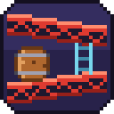

# DK94 Recomp — an unofficial static recompilation of Donkey Kong (Game Boy, 1994)

> **Unofficial fan project.** Not affiliated with, endorsed by or sponsored by
> Nintendo. Donkey Kong, Game Boy and Super Game Boy are trademarks of
> Nintendo. This repository contains **no** Nintendo code or data: you need
> your own copy of the game (and, optionally, of the Super Game Boy) — see
> [Legal](#legal).

Translates the Game Boy ROM's SM83 machine code into C and runs it natively
on a small runtime (PPU, APU, timer, MBC1, Super Game Boy) on SDL2, for
Linux and Windows.

The ROM is **not** included. You need
`Donkey Kong (World) (Rev 1) (SGB Enhanced).gb`
(SHA-1 `397ad2ff25627b83e02c71b54c72bb4deb39e0c0`).

There are two builds:

* **Player** (what the releases contain): has no game code in it. When you
  press PLAY it recompiles *your* ROM to C and compiles that in memory with
  [TinyCC](https://bellard.org/tcc/) (about 0.3 s), so nothing derived
  from the game is ever distributed or written to disk.
* **Developer build**: recompiles the ROM at build time and links the code
  in. Handy for development; the result contains game code, so it must
  not be shared.

Both run the same recompiler and produce identical results (verified with
the state-hash test below).

### Launcher

Run `dk94` (or double-click `dk94.exe`) with no arguments to open the
launcher:

* **Files.** It finds the ROM and SGB BIOS next to the executable or in the
  current directory, and checks them: the ROM by its CRC32 against the ROM
  this build was recompiled from, the BIOS by locating the SGB sound driver
  inside it. Each shows **OK**, **WRONG ROM** / **INVALID**, **MISSING**
  or **NOT SET**. PLAY is enabled only with the correct ROM; the BIOS is
  optional. Set files with **Browse…** (the standard file dialog on Windows,
  a built-in browser elsewhere) or by dropping them onto the window.
* **Options.** Hardware (Super Game Boy / Game Boy), display view, window
  scale, fullscreen, controller A/B layout, battery saves, CPU core
  (recompiled / interpreter) and speed (normal / uncapped). The focused
  option's line at the bottom explains it.
* Works with mouse (click; right-click or wheel changes values backwards),
  keyboard (arrows, Enter, Esc, Delete clears the BIOS) or controller
  (D-pad, A, Start = Play).
* Settings, including the file paths, are remembered in the per-user config
  folder (`launcher.ini` in SDL's pref path: `%APPDATA%\DK94\DK94-SGB` on
  Windows, `~/.local/share/DK94/DK94-SGB` on Linux).

Passing any command-line option skips the launcher (add `--launcher` to
show it anyway).

### Mods

HD graphics packs (tiles, sprites, backgrounds, SGB border) and music /
sound-effect replacements, several at once, managed in the launcher under
**MOD PACKS** (F9 toggles them in game). A dump tool extracts the game's
tiles, border and audio requests to start from. See [MODDING.md](MODDING.md).

An example pack, [examples/mods/DK94-Example](examples/mods/DK94-Example)
(included in the releases), adds an HD border, HD timer digits and a new
first-stage tune. It is all original work, generated by
[tools/make_example_pack.py](tools/make_example_pack.py).

### Super Game Boy sound (optional)

On a Super Game Boy, this game also plays sounds on the SNES side. That
needs the SGB's SNES sound driver and instrument samples, which live in the
Super Game Boy BIOS (the SNES cartridge ROM, e.g. `Super Game Boy (World).sfc`).
Supply your own dump with `--sgb-bios FILE`, or put it next to the
executable or in the current directory under one of these names:
`Super Game Boy (World).sfc`, `... (Rev 1).sfc`, `... (Rev 2).sfc`,
`Super Game Boy (Japan, USA).sfc`, `sgb.sfc`. Without it everything else
works and those SNES-side sounds are silent.

## Build

Requirements: CMake ≥ 3.16, Ninja (or make), a C11 compiler, Python ≥ 3.11
(build-time table generation only), SDL2. x86-64 only.

### Player (distributable)

```sh
cmake -S . -B build-player -G Ninja -DDK94_PLAYER=ON
ninja -C build-player      # downloads TinyCC 0.9.27 (SHA-256 checked) unless -DTINYCC_DIR=...
./build-player/dk94
```

Windows, cross-compiled from Linux/WSL with MinGW-w64:

```sh
# Arch: sudo pacman -S mingw-w64-gcc
# SDL2 dev package: SDL2-devel-2.32.10-mingw.tar.gz from github.com/libsdl-org/SDL/releases
cmake -S . -B build-win -G Ninja -DDK94_PLAYER=ON -DCMAKE_TOOLCHAIN_FILE=cmake/mingw-w64.cmake \
      -DSDL2_DIR=$PWD/third_party/sdl2-mingw/SDL2-2.32.10/x86_64-w64-mingw32/lib/cmake/SDL2
ninja -C build-win
```

`tools/make_release.sh VERSION` builds both players and packages them, with
the license notices, into `dist/` (see [Releases](#releases)).

### Developer build (contains game code - do not distribute)

```sh
cmake -S . -B build -G Ninja      # needs the ROM in the source directory (or -DDK94_ROM=...)
ninja -C build
./build/dk94
```

## Controls

| Game Boy | Keyboard | Controller |
|---|---|---|
| D-pad | Arrow keys | D-pad or left stick |
| A | X or K | A / Y (B / X with `--swap-ab`) |
| B | Z or J | B / X (A / Y with `--swap-ab`) |
| Start | Enter | Start |
| Select | Right Shift / Backspace | Back / View |

| Function | Keyboard | Controller |
|---|---|---|
| Fast-forward (hold) | Tab | RB or RT |
| Cycle display view | F10 | LB |
| Fullscreen | F11 | Guide |
| Mods on / off | F9 | – |
| Quit | Esc | – |

Any number of controllers can be used at once and plugged in or out while
the game runs. Controllers SDL doesn't recognise can be added with a
`gamecontrollerdb.txt` (SDL format, e.g. from the community
SDL_GameControllerDB project) placed next to the executable.
`--swap-ab` puts A/B in Nintendo positions (A on the right). Under WSL,
controllers are not visible to Linux programs (no `/dev/input`); use the
Windows build there. `DK94_PAD_SELFTEST=1 dk94` checks the controller code
with virtual controllers.

Battery RAM is saved to `<rom name>.sav`.

### Widescreen

Nothing is ever stretched; the game's pixels stay square and unscaled.
Choose a view in the launcher, with `--view`, or cycle with **F10** / **LB**:

| view | what you get |
|---|---|
| `original` (default) | the native image: 256×224 with the SGB border, or 160×144 |
| `frame` | 16:9 canvas (400×224 SGB, 256×144 DMG): the native image centred, with the sides filled by a blurred, darkened extension of it |
| `wide` **(experimental)** | true widescreen 256×144: the playfield rendered 48 px further on each side, using the game's own tilemap and sprites |

**`wide` is experimental.** Only a handful of screens and stages have been
checked with it. It shows only tilemap data that the game drew for the
current screen, and only up to the level's edges (no wrap-around), to keep
stale or bogus graphics out. On screens where there is nothing more to see,
the sides fall back to the `frame`-style blur. This covers menus,
cut-scenes and the many stages that are exactly one screen wide. Stages
wider than the screen (e.g. the scrolling jungle stages) show more of the
level. Known limitations: objects the game doesn't draw off-screen pop in
at the original screen edge, and untested stages may still show glitches
at the sides; switch to `frame` if they do. All views are render-only: the
emulation is identical in every view.

Options: `--mod NAME`, `--mods-dir DIR`, `--no-mods`, `--dump DIR`, `--dump-audio`, `--launcher`, `--fullscreen`, `--dmg` (plain Game Boy, no SGB border/colours), `--scale N`, `--view MODE` (`wide` is experimental), `--swap-ab`,
`--interp`, `--headless`, `--unthrottled`, `--frames N`, `--no-save`,
`--sgb-bios FILE`, `--input random:SEED`, `--hash-log FILE`, `--log-fallback FILE`,
`--screenshot FILE`, `--wav FILE`. See `dk94 --help`.

## How it works

```
runtime/recomp/ the recompiler (C): recomp.c = bank-aware control-flow
                discovery + C generation, used at runtime by the player and
                at build time by tools/recomp/dk94_recomp.c
runtime/        runtime: cpu.c (dispatcher + interpreter), mem.c (memory map,
                MBC1, IO, timer), ppu.c, apu.c, sgb.c, platform_sdl.c, main.c,
                native.c (player: compile with TinyCC), launcher.c, pad.c
                SGB sound: sgb_sound.c (SNES-side BIOS logic), spc.c (SPC700), dsp.c (S-DSP)
assets/icon/     the project icon (original pixel art), generated by tools/make_icon.py
tools/recomp/
  sm83.py         opcode table: every instruction's semantics as a C template
  gen_tables.py   build-time generator: opcode table, interpreter, game notes,
                  TinyCC prelude (none of it from the ROM)
  overrides.toml  game notes: jump-table/bank-switch routines, far-pointer
                  tables, expected ROM CRC32
  coverage.txt    ROM addresses seen executing at runtime (extra entry points)
  dk94_recomp.c   ahead-of-time recompiler CLI for the developer build
```

* **Analysis.** Starting from the reset and interrupt vectors, the analyzer
  follows jumps and calls, tracking the ROM bank selected by `ld a,N / rst 10h`.
  It understands the game's dispatch idioms: `rst 08h` / `call $0FD9` inline
  jump tables, `ld hl,TABLE … jp hl` local tables, the far-pointer table at
  `$2B48`, and pushed return addresses. Addresses from `coverage.txt` are
  added as further entry points.
* **Code generation.** Each entry point becomes a C function keyed by
  `(bank, address)`. Every instruction is a label and a resume point, so the
  dispatcher can re-enter a function after a `ret`, an interrupt or a bank
  switch. Code in the switchable bank checks the mapped bank before each
  instruction.
* **Compilation.** The developer build compiles the generated C with the
  system compiler. The player compiles it at startup with TinyCC (shipped
  as `libtcc.dll` / `libtcc.so`). The compiled code makes no external
  references; it reaches the runtime through pointers bound after loading,
  and a struct-layout probe checks both compilers agree before running it.
* **Execution.** The dispatcher looks up `(mapped bank, pc)` and runs the
  recompiled function, or the fallback interpreter when there is none (code
  in RAM, such as the OAM-DMA routine in HRAM, or ROM code the analysis
  missed). The interpreter is generated from the same opcode table, so it
  has identical semantics.
* **Timing.** Every instruction advances the PPU, timer and APU by its exact
  cycle count, and interrupts are checked before every instruction, in both
  the recompiled code and the interpreter.

* **SGB sound.** The game sends `SOUND` commands, and uses `SOU_TRN` to
  upload its own music score (to SPC `$2B00`) and a custom sample for the
  SGB's built-in sound driver. The runtime emulates the SNES audio chips
  (SPC700 CPU with timers, and the S-DSP with BRR decoding, envelopes, pitch
  modulation, noise and echo/FIR). It loads the driver from the BIOS
  dump (the IPL block list ending in a jump to `$0400`). The 65816 side of
  the BIOS is replaced by C re-implementations of its sound routines:
  `SOUND` → ports 0–3 with the per-frame echo handshake, and `SOU_TRN` → IPL
  re-upload. The SNES output (32 kHz) is resampled and mixed with the
  Game Boy APU.

## Verification

```sh
python3 tools/verify.py compare            # recompiled vs interpreter, per-frame state hashes
python3 tools/verify.py fallback           # how much ROM code still runs on the interpreter
python3 tools/verify.py coverage           # grow coverage.txt with random-input runs, then rebuild
```

`compare` runs each seed twice with deterministic pseudo-random input, once
with `--interp` and once with the recompiled code, and requires identical
hashes of the screen, WRAM, HRAM, registers and cycle count on every frame.
Current status: identical on 16 seeds × 20,000 frames. The Windows build
produces the same hashes as the Linux build. On unseen seeds no ROM code
falls back to the interpreter.

To recompile code reached only later in the game, play a reference build
with `--interp --log-fallback more.txt`, append the file to
`tools/recomp/coverage.txt`, and rebuild. Code that is still missing works
anyway, via the interpreter.

Debugging aids (environment variables): `DK94_TRACE=file` /
`DK94_TRACE_FROM=frame` (instruction, memory-write and WRAM/HRAM-read trace),
`DK94_POKE="frame:addr=val,...;..."`, `DK94_HOLD="from-to:buttons;..."`,
`DK94_DUMP_VRAM=file`, `DK94_WIDE_NOMASK=1`, `DK94_SGB_LOG=1`, `DK94_SPC_LOG=1`,
`DK94_DEBUG=1`, `DK94_LAUNCHER_CONFIG=file`, `DK94_LAUNCHER_KEYS=down,right,enter,...`,
`DK94_LAUNCHER_SHOT=file`, `DK94_RAMLOG=C000-C0FF`, `DK94_SGB_SOUND="frame:a,b,attr,score"`,
`DK94_PROFILE=1`. The current level index is at WRAM `$C85C`.

## Legal

* **What's here.** Only original source code (recompiler, runtime, tools)
  and notes about the game: addresses, routine descriptions and a list of
  executed code addresses (`tools/recomp/coverage.txt`). No ROM, BIOS,
  graphics, music, generated code or binaries.
* **What you supply.** The game ROM and the optional Super Game Boy BIOS
  must be dumped from hardware you own. This project does not link to or
  provide them.
* **Only distribute the player.** A *developer* build contains the game's
  code translated to C, i.e. Nintendo's copyrighted code in another form:
  never share it, or `build*/gen/`. The *player* build contains no game
  code; it recompiles the user's own ROM on their machine, in memory.
  `tools/make_release.sh` checks the packages for ROM data before release.
* **Clean implementation.** The S-DSP and SPC700 emulation were written from
  public hardware documentation (fullsnes, anomie's notes); hardware
  constants such as the envelope rate table are facts about the chip.
* **License.** The source code is MIT-licensed (see `LICENSE`). The license
  covers only the source in this repository, not the game ROM, the Super
  Game Boy BIOS or any code generated from them. SDL2 is zlib-licensed.
  TinyCC is LGPL-2.1; the player uses it as a separate, unmodified shared
  library, and releases include its license and source. The vendored stb
  libraries (`runtime/third_party/`, image and Ogg Vorbis decoding) are
  public domain / MIT.
* **Mods.** The only mod content shipped is the example pack, which is
  original work (drawn and composed by `tools/make_example_pack.py`); its
  tile file names are the 16-byte keys that identify the replaced tiles
  (MODDING.md). The dump tool writes the
  game's own graphics and sound from the user's ROM for local use; packs
  that are shared should contain original work only (see MODDING.md).

## Releases

`tools/make_release.sh VERSION` produces
`dist/DK94-Recomp-VERSION-windows-x64.zip` and
`dist/DK94-Recomp-VERSION-linux-x86_64.tar.gz`. Each contains the player,
`libtcc`, the license texts, a short readme, and TinyCC's source (LGPL);
the Windows package also has `SDL2.dll`. Linux needs SDL2 from the
distribution (e.g. `libsdl2-2.0-0`) and glibc 2.34 or newer.

## Limitations

* SGB sound needs a user-supplied SGB BIOS. The DSP uses a fitted Gaussian
  interpolation curve rather than the hardware's exact table, and is
  sample-accurate rather than cycle-accurate. `DATA_SND` code that the game
  injects into the SNES (a sprite tweak for the border) is not run.
* The PPU is scanline-based; mid-scanline register changes are not modelled.
  This game doesn't need them.
* The HALT bug and the exact timing of OAM DMA are not emulated.
